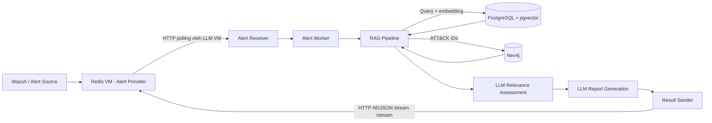
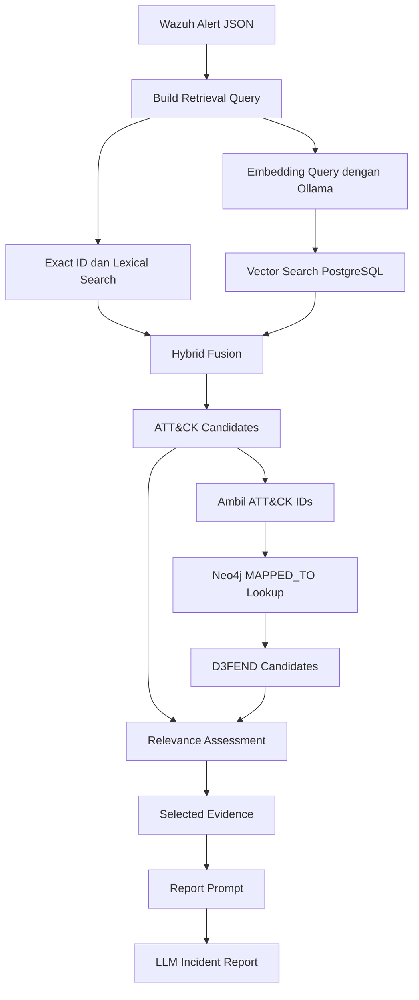
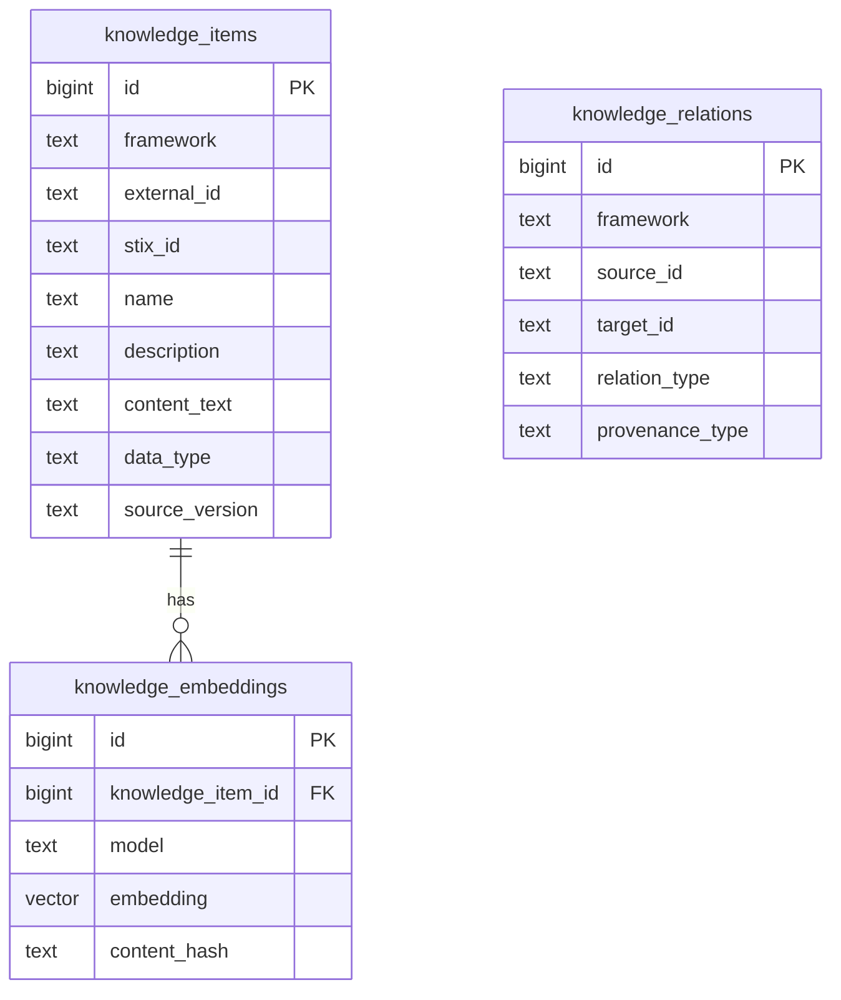

# Cyber RAG — Analisis Alert Wazuh dengan PostgreSQL, pgvector, Neo4j, dan Ollama

> Dokumentasi teknis proyek Cyber RAG. Dokumen ini menjelaskan komponen, alur data, proses ingest knowledge, retrieval, graph mapping, pipeline analisis, streaming hasil, deployment, konfigurasi, serta batasan implementasi berdasarkan source code dan konfigurasi proyek yang telah dibagikan.

---

## Daftar Isi

1. [Ringkasan Proyek](#1-ringkasan-proyek)
2. [Tujuan dan Prinsip Desain](#2-tujuan-dan-prinsip-desain)
3. [Cakupan Framework Knowledge](#3-cakupan-framework-knowledge)
4. [Arsitektur Sistem](#4-arsitektur-sistem)
5. [Alur Pemrosesan Alert End-to-End](#5-alur-pemrosesan-alert-end-to-end)
6. [Komponen Aplikasi](#6-komponen-aplikasi)
7. [Knowledge Pipeline dan Script](#7-knowledge-pipeline-dan-script)
8. [Desain Database PostgreSQL](#8-desain-database-postgresql)
9. [Desain Graph Database Neo4j](#9-desain-graph-database-neo4j)
10. [Embedding dan Vector Retrieval](#10-embedding-dan-vector-retrieval)
11. [Hybrid Retrieval](#11-hybrid-retrieval)
12. [Graph Retrieval ATTCK–D3FEND](#12-graph-retrieval-attckd3fend)
13. [LLM dan Prompt](#13-llm-dan-prompt)
14. [API dan Result Streaming](#14-api-dan-result-streaming)
15. [Konfigurasi Environment](#15-konfigurasi-environment)
16. [Docker dan Deployment](#16-docker-dan-deployment)
17. [Menyiapkan Knowledge Base](#17-menyiapkan-knowledge-base)
18. [Menjalankan dan Menguji Komponen](#18-menjalankan-dan-menguji-komponen)
19. [Timing dan Kinerja Pipeline](#19-timing-dan-kinerja-pipeline)
20. [Batasan Implementasi Saat Ini](#20-batasan-implementasi-saat-ini)
21. [Troubleshooting](#21-troubleshooting)
22. [Keamanan Operasional](#22-keamanan-operasional)
23. [Pengembangan Berikutnya](#23-pengembangan-berikutnya)
24. [Struktur Direktori](#24-struktur-direktori)

---

## 1. Ringkasan Proyek

Cyber RAG adalah aplikasi Retrieval-Augmented Generation (RAG) untuk membantu analisis alert keamanan yang berasal dari Wazuh. Aplikasi mengambil alert dari layanan penyedia alert pada VM Redis, menyusun konteks pencarian dari informasi alert, mengambil knowledge cybersecurity dari PostgreSQL/pgvector dan Neo4j, lalu menggunakan model bahasa melalui Ollama untuk menyusun analisis dan laporan insiden.

Sistem menggunakan dua pendekatan penyimpanan knowledge:

- **PostgreSQL + pgvector** untuk menyimpan metadata knowledge, relasi sumber, dan embedding yang digunakan oleh vector/hybrid retrieval.
- **Neo4j** untuk menyimpan node knowledge dan relasi graph, termasuk pemetaan resmi antara teknik MITRE ATT&CK dan teknik mitigasi D3FEND.

Ollama digunakan untuk dua pekerjaan berbeda:

1. Model embedding `nomic-embed-text:latest` untuk mengubah teks knowledge dan query menjadi vektor.
2. Model chat untuk melakukan penilaian relevansi evidence dan menghasilkan laporan analisis.

Aplikasi berjalan pada VM LLM. VM Redis menyediakan alert melalui endpoint HTTP yang dipolling oleh worker. Hasil analisis dikirim melalui HTTP streaming endpoint `/stream` pada VM LLM. Klien pada VM Redis membuka koneksi ke endpoint tersebut dan menerima hasil dalam format NDJSON.

### Sasaran utama

- Mengubah alert mentah menjadi konteks pencarian yang lebih ringkas dan relevan.
- Menghubungkan temuan alert dengan knowledge ATT&CK.
- Menghubungkan teknik ATT&CK yang ditemukan dengan mitigasi D3FEND melalui relasi graph.
- Mengurangi ketergantungan pada pencarian semantic similarity saja dengan menggabungkan exact identifier, lexical search, dan vector search.
- Memberikan evidence terstruktur kepada LLM sebelum laporan dibuat.
- Mengirim hasil analisis ke sistem lain melalui stream HTTP.

---

## 2. Tujuan dan Prinsip Desain

### 2.1 RAG sebagai penyedia konteks

Model bahasa tidak dianggap sebagai sumber knowledge utama. Model menerima konteks dari knowledge base yang telah diproses dan diambil oleh pipeline RAG. Kualitas analisis sangat dipengaruhi oleh:

- kualitas dan kelengkapan knowledge yang di-ingest;
- kualitas query yang dibangun dari alert;
- hasil retrieval;
- hubungan antar-entitas di graph;
- pemilihan evidence sebelum evidence dimasukkan ke prompt;
- kualitas prompt dan kemampuan model.

Karena itu, sistem memisahkan proses knowledge preparation, retrieval, graph lookup, relevance assessment, dan report generation.

### 2.2 Pemisahan vector database dan graph database

PostgreSQL/pgvector dan Neo4j tidak digunakan untuk fungsi yang sama.

| Komponen | Fungsi |
|---|---|
| PostgreSQL | Menyimpan item knowledge, metadata sumber, dan relasi knowledge |
| pgvector | Menyimpan embedding dan menjalankan pencarian berdasarkan jarak vektor |
| Neo4j | Menyimpan node dan edge untuk traversal relasi antar-framework |
| Ollama embedding model | Menghasilkan embedding dokumen dan query |
| Ollama chat model | Menilai evidence dan menghasilkan laporan |

Tahap vector/hybrid retrieval diselesaikan terlebih dahulu. Hasil ATT&CK dari PostgreSQL kemudian menjadi input untuk pencarian mapping ATT&CK–D3FEND pada Neo4j.

### 2.3 Pemrosesan alert yang spesifik

Query retrieval tidak dibuat dengan menyalin seluruh objek alert tanpa seleksi. Aplikasi mengambil sejumlah field yang dianggap berguna untuk pencarian, misalnya deskripsi alert, deskripsi rule, decoder, full log, source IP, destination user, serta informasi agent/host.

Tujuannya adalah memberi retrieval konteks perilaku yang diamati, bukan membanjiri retrieval dan prompt dengan seluruh struktur alert yang belum tentu relevan.

---

## 3. Cakupan Framework Knowledge

Dataset yang terlihat pada direktori framework proyek:

```text
data/frameworks/
├── attack/
│   └── enterprise-attack-20.0.json
└── d3fend/
    ├── d3fend-1.6.0.json
    ├── d3fend-full-mappings-1.6.0.json
    └── d3fend-full-mappings-1.6.0.json.save
```

### 3.1 MITRE ATT&CK

Sumber data yang digunakan adalah Enterprise ATT&CK STIX bundle versi 20.0.

Preprocessor memilih tipe objek tertentu, antara lain:

- `attack-pattern`
- `course-of-action`
- `x-mitre-data-component`
- `x-mitre-detection-strategy`
- `x-mitre-analytic`
- `malware`
- `tool`
- `intrusion-set`
- `campaign`
- `identity`
- `x-mitre-tactic`

Objek yang ditandai `revoked` atau `x_mitre_deprecated` tidak dimasukkan. ID eksternal dari referensi `mitre-attack` dipakai sebagai identifier utama apabila tersedia; jika tidak, STIX ID digunakan sebagai fallback.

Data ATT&CK yang diproses menyimpan nama, deskripsi, teks untuk embedding, tipe data, platform, URL sumber, versi, nama file, dan waktu modifikasi sumber.

Relasi yang diambil mencakup relasi STIX standar dan relasi detection strategy ke analytic (`has-analytic`) dari `x_mitre_analytic_refs`.

### 3.2 MITRE D3FEND

Sumber D3FEND yang digunakan adalah ontology JSON-LD versi 1.6.0.

Preprocessor mengambil entitas `owl:Class` dengan identifier `d3f:` dan label. Deskripsi diambil dari `d3f:definition`. Entitas embedded ATLAS/AML dikecualikan agar tidak dianggap sebagai entitas D3FEND.

Jika sebuah konsep tidak memiliki `d3f:d3fend-id`, preprocessor membuat identifier internal dengan awalan `ONTOLOGY:`. Identifier ini merupakan key internal, bukan klaim bahwa konsep tersebut memiliki ID resmi D3FEND.

Sejumlah properti ontology diproses sebagai relasi, seperti:

- `analyzes`
- `enables`
- `hardens`
- `monitors`
- `filters`
- `restricts`
- `maps`
- `restores`
- `authenticates`
- `blocks`
- `validates`
- `verifies`
- `encrypts`
- `terminates`
- `enforces`
- `quarantines`
- `configures`

Daftar lengkap properti yang didukung berada di `scripts/d3fend_pre.py`.

### 3.3 Mapping ATT&CK ke D3FEND

File `d3fend-full-mappings-1.6.0.json` digunakan oleh `sync_attack_d3fend_mappings.py`.

Script membaca mapping dari `results.bindings`, mengabaikan mapping dengan `framework_key` bernilai `sparta`, kemudian membentuk pasangan identifier ATT&CK dan D3FEND. Pasangan dideduplikasi sebelum ditulis ke Neo4j.

Script tidak membuat node framework baru pada tahap mapping. Script terlebih dahulu memeriksa apakah node ATT&CK dan D3FEND yang diharapkan sudah ada. Jika tidak ada pasangan yang cocok, proses dihentikan sebelum menulis edge mapping.

Relasi mapping disimpan sebagai:

```text
(:AttackItem)-[:MAPPED_TO]->(:D3FENDItem)
```

### 3.4 CAR dan ATLAS

Beberapa CLI retrieval menyediakan pilihan framework `car` dan `atlas`. Namun, pada inventory data yang dibagikan, dataset yang tersedia dan pipeline ingest yang ditunjukkan adalah ATT&CK dan D3FEND.

Karena itu, pilihan CLI tersebut tidak boleh dianggap sebagai bukti bahwa knowledge CAR dan ATLAS sudah di-ingest, di-embed, dan digunakan dalam pipeline produksi. Dukungan data CAR/ATLAS perlu diverifikasi dan dilengkapi secara terpisah sebelum dinyatakan aktif.

---

## 4. Arsitektur Sistem

### 4.1 Gambaran komponen



Diagram ini menggambarkan peran komponen. Koneksi polling alert dan koneksi stream hasil merupakan dua jalur HTTP yang berbeda.

### 4.2 Pemisahan VM

| Lokasi | Peran |
|---|---|
| VM Redis | Menyediakan alert melalui HTTP alert-provider endpoint dan menerima hasil melalui koneksi stream ke VM LLM |
| VM LLM | Menjalankan worker, RAG pipeline, PostgreSQL/pgvector, Neo4j, Ollama, dan HTTP result stream |

Alamat yang digunakan pada konfigurasi deployment yang dibagikan:

| Fungsi | Endpoint |
|---|---|
| Alert provider pada VM Redis | `http://103.252.50.212:17771/` |
| Result stream pada VM LLM | `http://38.47.66.253:17772/stream` |
| Ollama lokal pada VM LLM | `http://127.0.0.1:11434` |

Alamat di atas merupakan konfigurasi deployment saat dokumentasi disusun. Ganti sesuai lingkungan masing-masing dan jangan menganggap alamat publik tersebut sebagai default universal.

### 4.3 Mengapa Redis VM membuka koneksi stream?

Result stream disediakan oleh aplikasi pada VM LLM. Klien pada VM Redis melakukan koneksi HTTP ke endpoint `/stream`, lalu koneksi tersebut dipertahankan agar hasil dapat dikirim ketika pipeline selesai.

Dengan demikian, alur hasil bukanlah aplikasi LLM melakukan POST baru ke Redis untuk setiap laporan. Hasil ditulis ke koneksi stream yang sudah dibuka oleh klien.

---

## 5. Alur Pemrosesan Alert End-to-End

### 5.1 Tahapan pipeline

1. **Alert receiver melakukan polling.** Worker pada VM LLM meminta alert dari alert-provider endpoint pada VM Redis.
2. **Pemilihan alert.** Implementasi receiver yang dibagikan memilih alert terbaru berdasarkan `@timestamp`.
3. **Pemrosesan alert.** Alert diteruskan ke `alert_worker`, kemudian `process_alert()` memanggil `analyze_alert()`.
4. **Penyusunan retrieval query.** Pipeline membaca field alert yang relevan dan menyusun query ringkas.
5. **ATT&CK hybrid retrieval.** `retriever.py` menjalankan pencarian knowledge ATT&CK melalui PostgreSQL/pgvector dengan mode hybrid.
6. **Graph mapping retrieval.** ID ATT&CK yang diperoleh dipakai untuk mencari D3FEND yang terhubung melalui `MAPPED_TO` pada Neo4j.
7. **Relevance assessment.** Kandidat evidence diberikan kepada LLM untuk dinilai relevansinya terhadap alert.
8. **Report generation.** Evidence terpilih dan konteks alert digunakan untuk membangun prompt laporan insiden.
9. **Result packaging.** Worker membungkus laporan dan metadata status.
10. **Result streaming.** `result_sender.py` mengirim hasil dalam format NDJSON kepada klien yang sedang terhubung ke `/stream`.

### 5.2 Alur retrieval dan evidence



### 5.3 Catatan pemilihan alert dan kapasitas

Receiver yang memilih alert terbaru tidak sama dengan message queue yang menjamin setiap alert diproses. Bila alert baru datang ketika alert sebelumnya masih diproses, pemilihan newest-only berpotensi membuat alert yang lebih lama terlewati, tergantung perilaku endpoint provider.

Selain itu, identifier alert yang terakhir diproses disimpan di memori proses pada implementasi yang dibahas. State in-memory akan hilang ketika worker restart. Mekanisme ini tidak boleh disamakan dengan deduplikasi persisten atau jaminan exactly-once processing.

---

## 6. Komponen Aplikasi

Direktori aplikasi yang dibagikan memiliki komponen utama berikut.

```text
app/
├── api/
│   └── main.py
├── prompts/
│   ├── loader.py
│   └── [file prompt]
├── config.py
├── graph_retriever.py
├── rag_pipeline.py
├── report_generator.py
├── retriever.py
├── timing.py
└── workers/
    ├── alert_receiver.py
    ├── alert_worker.py
    ├── pipeline_worker.py
    └── result_sender.py
```

Nama file prompt yang pernah dibagikan mencakup `relevance_assessment_id.md` dan `promptsid.md`. Gunakan nama aktual di repository ketika menambahkan atau mengubah file; nama tersebut tidak perlu direkonstruksi dari dokumentasi ini.

### 6.1 `app/config.py`

Memuat konfigurasi aplikasi dari environment dan menyediakan default untuk beberapa komponen.

Konfigurasi yang diketahui dari source:

| Pengaturan | Nilai/default yang diketahui | Keterangan |
|---|---|---|
| `OLLAMA_BASE_URL` | `http://127.0.0.1:11434` | Base URL Ollama |
| Chat model | `Qwen3.6-27B-Q4_K_S:latest` | Model chat yang dipilih pada konfigurasi yang dibagikan |
| Daftar model tersedia | `orcasaq-cyber:latest`, `Qwen3.6-27B-Q4_K_S:latest`, `qwen2.5:3b` | Pilihan model yang tercantum |
| Embedding model | `nomic-embed-text:latest` | Model embedding |
| Embedding URL | Default Ollama lokal | Endpoint embedding |
| `DATABASE_URL` | Wajib tersedia | Koneksi PostgreSQL |

Konfigurasi juga memuat bobot relationship/data type dan stopwords untuk proses ranking evidence. Nilai persisnya mengikuti file konfigurasi aktual.

### 6.2 `app/prompts/loader.py`

Bertanggung jawab memuat prompt dari direktori prompt agar prompt tidak perlu ditulis langsung di seluruh kode pipeline.

Pemisahan prompt dan kode membantu pemeliharaan instruksi model. Perubahan prompt tetap perlu diuji bersama parser/output schema yang mengonsumsi jawaban model.

### 6.3 `app/retriever.py`

Menangani retrieval knowledge berbasis PostgreSQL. Pada alur aplikasi, pencarian framework dijalankan dengan memanggil script `scripts/search_knowledge.py` menggunakan mode hybrid, framework yang ditentukan, nilai `-k`, dan output JSON.

Komponen ini juga menyusun retrieval query dari alert. Field yang pernah dikonfirmasi meliputi:

- `alert_description`;
- `original.rule.description`;
- Wazuh rule ID;
- `original.full_log`;
- source IP;
- destination user.

Jika `original` disimpan sebagai string JSON, data tersebut perlu di-parse sebelum field turunannya diakses.

### 6.4 `app/graph_retriever.py`

Menghubungkan aplikasi dengan Neo4j dan mengambil D3FEND mapping dari daftar ID ATT&CK.

Pola graph yang digunakan:

```cypher
MATCH (a:AttackItem)-[r:MAPPED_TO]->(d:D3FENDItem)
WHERE a.external_id IN $attack_ids
RETURN ...
```

Hasil memuat informasi D3FEND, ATT&CK yang menjadi sumber mapping, serta metadata relasi/provenance. Jika daftar ATT&CK ID kosong, fungsi mengembalikan list kosong tanpa menjalankan pencarian mapping.

### 6.5 `app/rag_pipeline.py`

Orkestrator proses analisis. `analyze_alert()` menjalankan tahap penyusunan query, retrieval ATT&CK, pengambilan mapping D3FEND, relevance assessment, dan pembuatan laporan.

Bentuk hasil yang telah terlihat dari implementasi:

- `report`;
- `evidence`;
- `metadata`.

Evidence mencakup konteks alert, retrieval query/hasil, dan hasil penilaian relevansi. Metadata mencakup informasi model, timestamp, statistik retrieval, serta identifier ATT&CK/D3FEND yang dipilih.

### 6.6 `app/report_generator.py`

Mengelola interaksi LLM untuk penilaian relevansi evidence dan pembuatan laporan. Tahap penilaian relevansi dimaksudkan untuk menyaring kandidat yang ditemukan retrieval sebelum kandidat tersebut dipakai dalam laporan akhir.

Tahap report generation menggunakan prompt laporan dan evidence terpilih. Format akhir laporan yang dibungkus worker adalah Markdown.

### 6.7 `app/workers/alert_receiver.py`

Mengambil alert dari endpoint provider. Komponen ini menangani komunikasi HTTP/polling dari VM LLM ke VM Redis dan meneruskan alert ke callback pipeline.

### 6.8 `app/workers/alert_worker.py`

Memproses satu alert. Fungsi yang diketahui:

- `get_alert_id()` mencari identifier dari `alert_id`, `id`, atau `log_uuid`;
- jika tidak ditemukan, fungsi mencoba mengambil `log_uuid` dari `alert_description`;
- `process_alert()` memanggil `analyze_alert()`;
- hasil sukses dikemas dengan status `completed`, timestamp, format laporan, dan isi laporan;
- jika analisis gagal, hasil dikemas dengan status `failed` dan pesan error;
- `process_message()` menangani parsing JSON serta validasi bahwa pesan masuk merupakan objek JSON.

### 6.9 `app/workers/pipeline_worker.py`

Menjalankan worker utama: menerima alert melalui `receive_alerts`, menjalankan pemrosesan alert, kemudian memanggil result sender untuk mempublikasikan hasil.

Pemrosesan blocking dipindahkan ke thread melalui `asyncio.to_thread()` pada implementasi yang dibagikan. Pipeline juga menggunakan pengukuran waktu untuk menghitung total waktu pemrosesan callback.

### 6.10 `app/workers/result_sender.py`

Menyediakan HTTP streaming server berbasis aiohttp.

Karakteristik yang diketahui:

- path default stream: `/stream`;
- response menggunakan `StreamResponse`;
- hasil dikirim sebagai NDJSON, yaitu satu objek JSON per baris;
- koneksi klien aktif disimpan dalam collection `listeners`;
- hasil dipublikasikan kepada klien yang sedang terhubung;
- heartbeat dikirim secara berkala (30 detik pada implementasi yang dibagikan).

### 6.11 `app/api/main.py`

File API aplikasi. Detail route selain endpoint stream yang disediakan result sender harus mengikuti source aktual. Endpoint `/` tidak boleh diasumsikan sebagai endpoint stream; endpoint hasil yang dikonfigurasi adalah `/stream`.

### 6.12 `app/timing.py`

Menyediakan context manager `measure(name)` yang mengukur durasi menggunakan `time.perf_counter()` dan mencetak:

```text
[TIMING] Nama tahap: 12.34s
```

Timer bersifat observabilitas lokal melalui log; bukan metrik monitoring terpusat.

---

## 7. Knowledge Pipeline dan Script

Script pada direktori `scripts/` digunakan untuk menyiapkan data knowledge, membuat embedding, menguji retrieval, dan menyinkronkan graph.

### 7.1 Inventaris script

| Script | Tanggung jawab |
|---|---|
| `attack_pre.py` | Membaca ATT&CK STIX bundle, memilih objek yang didukung, membentuk item dan relasi |
| `ingest_attack.py` | Memasukkan item dan relasi ATT&CK ke PostgreSQL |
| `embed_attack.py` | Membuat/memperbarui embedding item ATT&CK |
| `d3fend_pre.py` | Membaca ontology D3FEND dan mengekstrak entitas serta relasi |
| `ingest_d3fend.py` | Memasukkan entitas dan relasi D3FEND ke PostgreSQL |
| `embed_d3fend.py` | Membuat/memperbarui embedding D3FEND |
| `search_knowledge.py` | CLI vector atau hybrid retrieval untuk knowledge |
| `test_alert_retrieval.py` | Menguji retrieval menggunakan file alert JSON |
| `test_semantic_lookup.py` | Menguji semantic lookup |
| `sync_attack_to_neo4j.py` | Menyalin node dan relasi ATT&CK dari PostgreSQL ke Neo4j |
| `sync_d3fend_to_neo4j.py` | Menyalin node dan relasi D3FEND dari PostgreSQL ke Neo4j |
| `sync_attack_d3fend_mappings.py` | Membuat edge mapping ATT&CK–D3FEND pada Neo4j |
| `graph_rangking.py` | Menjalankan pengujian retrieval/ranking graph tanpa memanggil LLM dan menyimpan hasil JSON |

Nama `graph_rangking.py` ditulis sesuai nama file yang dibagikan.

### 7.2 `attack_pre.py`

Fungsi utama:

- membaca STIX bundle;
- memilih tipe objek ATT&CK yang didukung;
- mengecualikan objek revoked/deprecated;
- mengambil external ID MITRE ATT&CK;
- membuat `content_text` dari nama dan deskripsi;
- menyimpan platform dan metadata sumber;
- mengekstrak relasi STIX;
- membentuk relasi `has-analytic` dari detection strategy ke analytic.

### 7.3 `ingest_attack.py`

Memanggil `load_attack()` dan `load_relations()`, kemudian melakukan upsert ke `knowledge_items` dan `knowledge_relations`.

Konflik item ditangani berdasarkan unique key `(framework, external_id)`. Data yang sudah ada diperbarui dengan informasi terbaru dari sumber.

### 7.4 `embed_attack.py`

Membaca item ATT&CK yang memiliki `content_text`, menghitung SHA-256 content hash, lalu membandingkan hash dengan embedding yang sudah tersimpan.

Embedding yang tidak berubah dilewati. Embedding yang belum ada atau kontennya berubah dikirim ke Ollama dalam batch berukuran 32. Hasil disimpan ke `knowledge_embeddings` dengan model `nomic-embed-text:latest` dan dimensi 768.

### 7.5 `d3fend_pre.py`

Membaca JSON-LD D3FEND. Fungsi `load_d3fend()` membentuk item ontology, sedangkan `load_d3fend_relations()` mengambil properti relasi yang didukung. ID ontology digunakan sebagai identitas stabil untuk deduplikasi.

### 7.6 `ingest_d3fend.py`

Mengambil entitas dan relasi dari preprocessor lalu melakukan upsert ke PostgreSQL. Opsi `--mappings-only` saat ini tidak mengimpor mapping; script secara eksplisit menghentikan eksekusi dengan pesan bahwa fungsi tersebut belum diimplementasikan pada script ini.

Mapping ATT&CK–D3FEND ditangani oleh script terpisah `sync_attack_d3fend_mappings.py`.

### 7.7 `embed_d3fend.py`

Membuat embedding D3FEND dengan model dan dimensi yang sama seperti ATT&CK. Script menggunakan batch 32 dan content hash. Opsi `--force` memaksa pembuatan ulang seluruh embedding D3FEND.

### 7.8 `search_knowledge.py`

CLI retrieval menyediakan:

- `--mode vector`: pencarian berdasarkan embedding;
- `--mode hybrid`: exact ID + lexical + vector;
- `--framework`: filter framework;
- `-k`: jumlah hasil akhir;
- `--json`: output JSON.

Pilihan framework CLI yang tercantum adalah `attack`, `d3fend`, `car`, dan `atlas`. Keberadaan pilihan CLI tidak otomatis berarti dataset framework tersebut telah tersedia.

Pada hybrid mode, jumlah kandidat awal ditingkatkan menjadi minimal 50 atau lima kali nilai `-k`, kemudian hasil dari beberapa jalur digabung menggunakan Reciprocal Rank Fusion (RRF).

### 7.9 `test_alert_retrieval.py`

Script uji retrieval yang menerima path alert JSON. Script mengambil field alert yang relevan, menghasilkan embedding query, menjalankan vector dan lexical retrieval, lalu menggabungkan hasil dengan RRF.

Script ini merupakan alat pengujian retrieval berbasis file alert, bukan komponen penerima alert otomatis produksi.

### 7.10 `test_semantic_lookup.py`

Digunakan untuk pengujian semantic lookup. Detail skenario dan argumen harus mengikuti isi script aktual.

### 7.11 `sync_attack_to_neo4j.py`

Membaca item ATT&CK dan relasi dari PostgreSQL, kemudian:

- membuat constraint unik `AttackItem.key`;
- melakukan upsert node `AttackItem`;
- membuat edge `RELATED_TO`;
- memproses data per batch 500;
- hanya membuat relasi apabila kedua endpoint node tersedia di data item ATT&CK.

Key node dibentuk dari `attack:` ditambah STIX ID.

### 7.12 `sync_d3fend_to_neo4j.py`

Memiliki pola serupa untuk D3FEND:

- label node `D3FENDItem`;
- constraint unik `D3FENDItem.key`;
- edge ontology `RELATED_TO`;
- batch 500;
- key node `d3fend:` ditambah STIX ID.

### 7.13 `sync_attack_d3fend_mappings.py`

Membaca mapping JSON D3FEND, mengabaikan SPARTA, menghapus duplikasi pasangan ATT&CK–D3FEND, lalu memeriksa node yang sudah ada di Neo4j.

Jika tidak ada pasangan lengkap yang cocok, script berhenti sebelum menulis mapping. Jika pasangan cocok, script melakukan `MERGE` edge `MAPPED_TO` dan menyimpan identifier, label, URI sumber, file mapping, serta provenance.

### 7.14 `graph_rangking.py`

Script diagnostik ini memanggil `retrieve_evidence()` dan `rank_evidence()` dari modul `run_graph_rag`, kemudian menampilkan:

- alert context;
- seluruh kandidat ATT&CK yang telah diranking;
- seluruh kandidat D3FEND yang telah diranking;
- evidence ATT&CK terpilih;
- mapping D3FEND terpilih.

Hasil disimpan sebagai `data/reports/ranking_test.json`. Script menyatakan secara eksplisit bahwa tidak ada request LLM yang dibuat pada proses tersebut.

---

## 8. Desain Database PostgreSQL

Database relasional menjadi sumber penyimpanan knowledge dan embedding untuk retrieval.

### 8.1 Ekstensi

```sql
CREATE EXTENSION IF NOT EXISTS vector;
```

Ekstensi `vector` menyediakan tipe data vector dan operator jarak yang digunakan pgvector.

### 8.2 Tabel `knowledge_items`

Menyimpan entitas knowledge dari framework.

| Kolom | Tipe | Fungsi |
|---|---|---|
| `id` | `BIGSERIAL` | Primary key internal |
| `framework` | `TEXT` | Nama framework |
| `external_id` | `TEXT` | Identifier framework |
| `stix_id` | `TEXT` | Identifier STIX/ontology bila tersedia |
| `name` | `TEXT` | Nama item |
| `description` | `TEXT` | Deskripsi |
| `content_text` | `TEXT` | Konten yang digunakan untuk embedding |
| `data_type` | `TEXT` | Tipe objek |
| `platforms` | `TEXT[]` | Platform terkait, terutama ATT&CK |
| `source_url` | `TEXT` | URL sumber |
| `source_version` | `TEXT` | Versi dataset |
| `source_file` | `TEXT` | File sumber |
| `source_modified` | `TIMESTAMPTZ` | Waktu modifikasi sumber |
| `created_at` | `TIMESTAMPTZ` | Waktu record dibuat |

Unique constraint:

```sql
UNIQUE (framework, external_id)
```

### 8.3 Tabel `knowledge_relations`

Menyimpan relasi knowledge yang berasal dari dataset sumber.

| Kolom | Tipe | Fungsi |
|---|---|---|
| `id` | `BIGSERIAL` | Primary key internal |
| `framework` | `TEXT` | Framework asal relasi |
| `source_id` | `TEXT` | Identifier node sumber |
| `target_id` | `TEXT` | Identifier node tujuan |
| `relation_type` | `TEXT` | Jenis relasi |
| `provenance_type` | `TEXT` | Asal/provenance relasi |
| `description` | `TEXT` | Deskripsi relasi |
| `source_version` | `TEXT` | Versi sumber |
| `source_file` | `TEXT` | File sumber |
| `created_at` | `TIMESTAMPTZ` | Waktu record dibuat |

Unique constraint terdiri dari framework, source, target, relation type, dan provenance type.

### 8.4 Tabel `knowledge_embeddings`

Menyimpan embedding untuk setiap item knowledge dan model embedding.

| Kolom | Tipe | Fungsi |
|---|---|---|
| `id` | `BIGSERIAL` | Primary key internal |
| `knowledge_item_id` | `BIGINT` | FK ke `knowledge_items.id` |
| `model` | `TEXT` | Nama model embedding |
| `embedding` | `VECTOR(768)` | Vektor embedding 768 dimensi |
| `content_hash` | `TEXT` | Hash konten untuk mendeteksi perubahan |
| `created_at` | `TIMESTAMPTZ` | Waktu embedding dibuat/diperbarui |

Foreign key menggunakan `ON DELETE CASCADE`. Unique constraint `(knowledge_item_id, model)` mencegah embedding ganda untuk item dan model yang sama.

### 8.5 Index

Schema membuat index untuk:

- `knowledge_items.framework`;
- `knowledge_items.stix_id`;
- `knowledge_relations.source_id`;
- `knowledge_relations.target_id`;
- embedding menggunakan HNSW dengan `vector_cosine_ops`.

Index HNSW digunakan untuk mendukung pencarian nearest-neighbor berbasis cosine distance.

### 8.6 Hubungan tabel



`knowledge_relations` menggunakan identifier sumber/tujuan, bukan foreign key langsung ke `knowledge_items`. Karena itu, integritas endpoint relasi perlu dijaga oleh proses ingest/sync.

---

## 9. Desain Graph Database Neo4j

Neo4j digunakan untuk traversal relasi knowledge, bukan sebagai pengganti vector retrieval PostgreSQL.

### 9.1 Label node

| Label | Isi |
|---|---|
| `AttackItem` | Item ATT&CK |
| `D3FENDItem` | Entitas D3FEND |

Kedua jenis node menyimpan identifier, nama, deskripsi, content text, data type, framework, dan versi sumber. Node ATT&CK juga menyimpan platform.

### 9.2 Relasi graph

| Relasi | Makna |
|---|---|
| `RELATED_TO` | Relasi internal dalam framework berdasarkan data sumber |
| `MAPPED_TO` | Mapping ATT&CK ke D3FEND |

Pola mapping utama:

```text
(AttackItem)-[:MAPPED_TO]->(D3FENDItem)
```

Relasi `MAPPED_TO` menyimpan metadata seperti `attack_id`, `d3fend_id`, label kedua sisi, URI sumber, nama file mapping, dan provenance.

### 9.3 Alasan graph digunakan setelah vector retrieval

Vector/hybrid retrieval menjawab pertanyaan: knowledge ATT&CK apa yang paling dekat atau cocok dengan konteks alert?

Graph retrieval menjawab pertanyaan lanjutan: jika teknik ATT&CK tersebut ditemukan, mitigasi D3FEND apa yang secara eksplisit dipetakan kepadanya?

Dengan urutan ini, graph traversal dibatasi oleh hasil retrieval ATT&CK, bukan melakukan pencarian seluruh graph tanpa konteks.

---

## 10. Embedding dan Vector Retrieval

### 10.1 Model embedding

Model yang digunakan:

```text
nomic-embed-text:latest
```

Endpoint embedding:

```text
http://localhost:11434/api/embed
```

Dimensi embedding:

```text
768
```

Dokumen dikirim dengan prefix:

```text
search_document:
```

Query dikirim dengan prefix:

```text
search_query:
```

Prefix membedakan konteks pembuatan embedding dokumen dan embedding query.

### 10.2 Proses embedding dokumen

1. Ambil `content_text` dari `knowledge_items`.
2. Hitung SHA-256 hash dari konten.
3. Bandingkan hash dengan `content_hash` yang sudah tersimpan.
4. Lewati item yang kontennya tidak berubah.
5. Kirim item yang perlu diproses ke Ollama dalam batch 32.
6. Validasi jumlah embedding dan dimensi 768.
7. Upsert hasil ke `knowledge_embeddings`.

Keuntungan content hash adalah proses embedding ulang tidak harus dilakukan untuk seluruh knowledge setiap kali script dijalankan.

### 10.3 Vector similarity

Vector retrieval mengurutkan item berdasarkan cosine distance antara embedding query dan embedding dokumen. Query SQL menggunakan operator `<=>` dan menghitung similarity sebagai:

```sql
1 - (embedding <=> query_embedding)
```

Filter framework dapat diterapkan agar pencarian dibatasi ke satu framework.

---

## 11. Hybrid Retrieval

Hybrid retrieval menggabungkan tiga jalur pencarian:

1. **Exact ID** — mencari identifier framework yang disebut eksplisit pada query.
2. **Lexical search** — mencari kecocokan istilah menggunakan PostgreSQL full-text search.
3. **Vector search** — mencari kemiripan semantik menggunakan embedding.

### 11.1 Exact identifier

`extract_ids()` mengenali pola identifier seperti:

- ATT&CK technique/sub-technique: `T####` atau `T####.###`;
- software: `S####`;
- group: `G####`;
- malware: `M####`;
- detection/analytic ID: `DET####` dan `AN####`;
- D3FEND ID: `D3-...`.

Exact lookup berguna ketika alert atau query sudah menyebut identifier secara eksplisit. Jalur ini tidak bergantung pada kemiripan embedding.

### 11.2 Lexical retrieval

Token query dipisahkan, dibuat menjadi query `to_tsquery` dengan operator OR, dan digunakan untuk mencari kecocokan pada gabungan:

- external ID;
- nama;
- deskripsi;
- content text.

Konfigurasi text search menggunakan dictionary `simple`. Prefix matching digunakan melalui `:*`.

### 11.3 Vector retrieval

Query diubah menjadi embedding dengan Ollama. PostgreSQL mengurutkan knowledge berdasarkan cosine distance.

### 11.4 Reciprocal Rank Fusion

Hasil exact-ID, lexical, dan vector digabung dengan Reciprocal Rank Fusion (RRF). Bentuk skor yang digunakan:

\[
RRF(d) = \sum_{r \in R(d)} \frac{1}{k + rank_r(d)}
\]

Implementasi menggunakan nilai `k = 60`. Dokumen yang muncul di beberapa jalur retrieval dapat memperoleh skor gabungan lebih tinggi.

Pada `search_knowledge.py`, hybrid mode mengambil kandidat awal minimal 50 atau lima kali `-k`, kemudian memilih `-k` hasil teratas setelah fusion.

### 11.5 Contoh penggunaan CLI

Vector search:

```bash
python scripts/search_knowledge.py \
  "suspicious process access to LSASS" \
  --framework attack \
  --mode vector \
  -k 10
```

Hybrid search:

```bash
python scripts/search_knowledge.py \
  "LSASS memory dumping T1003.001" \
  --framework attack \
  --mode hybrid \
  -k 10
```

Output JSON:

```bash
python scripts/search_knowledge.py \
  "LSASS memory dumping T1003.001" \
  --framework attack \
  --mode hybrid \
  -k 10 \
  --json
```

Nama script dan argumen di atas mengikuti CLI yang tersedia pada source script.

---

## 12. Graph Retrieval ATT&CK–D3FEND

Setelah ATT&CK retrieval selesai, aplikasi mengambil identifier ATT&CK dari hasil tersebut dan mengirimkannya ke Neo4j.

Query graph mencari node `AttackItem` dengan `external_id` yang termasuk dalam daftar tersebut, lalu mengikuti edge `MAPPED_TO` ke `D3FENDItem`.

Hasil graph dapat memuat:

- D3FEND external/STIX identifier;
- nama dan deskripsi D3FEND;
- data type;
- ATT&CK ID yang memicu mapping;
- metadata relasi;
- provenance mapping.

Pencarian ini mengandalkan edge mapping yang telah dibuat sebelumnya oleh `sync_attack_d3fend_mappings.py`.

### 12.1 Perbedaan relasi ontology dan mapping

Jangan mencampuradukkan dua jenis relasi berikut:

- `RELATED_TO`: relasi di dalam framework yang disinkronkan dari data ontology/STIX.
- `MAPPED_TO`: hubungan lintas framework ATT&CK ke D3FEND.

Keduanya memiliki fungsi dan sumber yang berbeda.

---

## 13. LLM dan Prompt

### 13.1 Model

Konfigurasi yang dibagikan menunjukkan model chat utama:

```text
Qwen3.6-27B-Q4_K_S:latest
```

Model lain yang tercantum sebagai pilihan:

```text
orcasaq-cyber:latest
qwen2.5:3b
```

Model embedding terpisah:

```text
nomic-embed-text:latest
```

Model chat dan embedding tidak boleh tertukar: model embedding menghasilkan vector, sedangkan model chat mengonsumsi evidence dan menghasilkan teks/JSON sesuai prompt.

### 13.2 Relevance assessment

Tahap ini menilai apakah kandidat ATT&CK dan D3FEND benar-benar relevan dengan alert. Tujuannya mengurangi evidence yang tidak berkaitan sebelum report generation.

Penilaian perlu berlandaskan bukti alert dan knowledge yang diberikan. Kemunculan istilah yang mirip saja tidak cukup untuk menyatakan sebuah teknik terjadi.

Prompt relevance assessment berada pada direktori `app/prompts/` dan dimuat melalui prompt loader. Nama file prompt harus dipertahankan sesuai source aktual.

### 13.3 Report generation

Setelah relevance assessment, pipeline menyusun prompt laporan dengan konteks alert dan evidence yang dipilih. Model menghasilkan laporan insiden dalam format Markdown.

### 13.4 Batas interpretasi

Output LLM adalah analisis berbantuan evidence, bukan bukti forensik mandiri. Hasil harus tetap diverifikasi oleh analis berdasarkan log, telemetry, dan sumber primer. Jika evidence tidak cukup, laporan seharusnya tidak mengubah indikasi menjadi kepastian.

---

## 14. API dan Result Streaming

### 14.1 Endpoint stream

Endpoint hasil yang digunakan:

```text
GET /stream
```

Konfigurasi default deployment:

```text
Host: 0.0.0.0
Port: 17772
Path: /stream
```

URL klien pada konfigurasi deployment:

```text
http://38.47.66.253:17772/stream
```

Aplikasi menyediakan koneksi stream menggunakan aiohttp `StreamResponse`.

### 14.2 Format NDJSON

Hasil dikirim sebagai JSON per baris (Newline Delimited JSON). Contoh ilustratif:

```json
{"alert_id":"example-id","status":"completed","report_format":"markdown","incident_report":"# Incident Analysis"}
{"alert_id":"example-id-2","status":"failed","error":"analysis error"}
```

Setiap baris adalah satu objek JSON independen. Konsumen stream harus membaca data per baris, bukan menganggap seluruh koneksi sebagai satu dokumen JSON.

Nama field identifier mengikuti implementasi worker aktif. Pada source yang dibagikan, identifier dicari dari `alert_id`, `id`, atau `log_uuid`; periksa versi `alert_worker.py` yang benar-benar dideploy sebelum mengikat kontrak integrasi ke satu nama field tertentu.

### 14.3 Heartbeat dan koneksi

Server mengirim heartbeat berkala untuk menjaga koneksi stream tetap aktif. Klien sebaiknya memiliki mekanisme reconnect dengan jeda yang dikonfigurasi.

### 14.4 Menguji stream

Dari mesin klien:

```bash
curl -N http://38.47.66.253:17772/stream
```

Opsi `-N` menonaktifkan buffering output curl agar data stream ditampilkan segera ketika diterima.

Route `/` bukan endpoint stream. Mengakses root URL dan menerima 404 tidak berarti endpoint `/stream` gagal.

### 14.5 Broadcast listener

Result sender menyimpan koneksi klien aktif dalam collection `listeners` dan mengirim hasil ke listener yang terhubung. Pola ini merupakan broadcast ke koneksi aktif, bukan mekanisme durable message queue.

Jika tidak ada listener aktif ketika hasil akan dipublikasikan, implementasi sender dapat mengembalikan status gagal publish. Perilaku retry ditentukan oleh pipeline worker.

---

## 15. Konfigurasi Environment

Buat file `.env` di root proyek. Jangan commit `.env` yang berisi password, token, atau credential.

Contoh template:

```dotenv
POSTGRES_PASSWORD=
NEO4J_PASSWORD=

DATABASE_URL=postgresql+psycopg://raguser:<PASSWORD>@localhost:5433/cyber_rag

NEO4J_URI=bolt://localhost:7688
NEO4J_USER=neo4j

# LLM VM - outgoing analysis result stream
LLM_STREAM_HOST=0.0.0.0
LLM_STREAM_PORT=17772
LLM_STREAM_PATH=/stream

# Redis VM - connects to the LLM stream
LLM_STREAM_URL=http://<LLM_VM_PUBLIC_IP>:17772/stream

# Stream reconnection
STREAM_RECONNECT_DELAY=5
```

### 15.1 Penjelasan variabel

| Variabel | Fungsi |
|---|---|
| `POSTGRES_PASSWORD` | Password user PostgreSQL yang dibuat oleh Compose |
| `NEO4J_PASSWORD` | Password user Neo4j |
| `DATABASE_URL` | SQLAlchemy connection URL untuk PostgreSQL |
| `NEO4J_URI` | Bolt URI Neo4j |
| `NEO4J_USER` | Username Neo4j |
| `NEO4J_PASSWORD` | Password Neo4j |
| `LLM_STREAM_HOST` | Interface bind result stream server |
| `LLM_STREAM_PORT` | Port result stream |
| `LLM_STREAM_PATH` | Path endpoint stream |
| `LLM_STREAM_URL` | URL stream yang diakses klien VM Redis |
| `STREAM_RECONNECT_DELAY` | Jeda reconnect klien stream dalam detik |

**Penting:** port host PostgreSQL pada Compose adalah `5433`, sedangkan port internal container PostgreSQL adalah `5432`. Port host Neo4j Bolt pada Compose adalah `7688`, sedangkan port internal container adalah `7687`. Karena aplikasi menggunakan host networking, koneksi dari aplikasi ke database container menggunakan port host yang dipublikasikan.

Contoh `NEO4J_URI` untuk aplikasi yang berjalan pada host dengan Compose di atas adalah `bolt://localhost:7688`. Jika konfigurasi deployment aktual menggunakan port lain, sesuaikan nilainya.

---

## 16. Docker dan Deployment

### 16.1 Service Compose

Compose mendefinisikan tiga service:

| Service | Image/build | Fungsi |
|---|---|---|
| `postgres` | `pgvector/pgvector:pg16` | Database relational dan vector |
| `neo4j` | `neo4j:5` | Graph database |
| `app` | Build dari `Dockerfile` | Worker/pipeline dan result stream |

### 16.2 Port mapping

| Host | Container | Fungsi |
|---|---|---|
| `5433` | `5432` | PostgreSQL |
| `7475` | `7474` | Neo4j Browser/HTTP |
| `7688` | `7687` | Neo4j Bolt |
| `17772` | Host network | Result stream aplikasi |

Service `app` menggunakan `network_mode: host`. Karena itu, aplikasi menggunakan network namespace host dan dapat mengakses Ollama lokal melalui `127.0.0.1:11434`.

### 16.3 Volume persisten

Compose menggunakan named volume:

- `cyber_rag_pgdata`;
- `cyber_rag_neo4j_data`;
- `cyber_rag_neo4j_logs`.

Volume ini menyimpan data database agar tetap ada ketika container dihentikan atau dibuat ulang.

**Jangan menggunakan `docker compose down -v` pada deployment yang berisi data penting**, karena opsi `-v` menghapus named volume yang terpasang pada Compose.

### 16.4 Dockerfile dan offline wheelhouse

Dockerfile menggunakan Python `3.12.3-slim`, menyalin `wheelhouse/`, lalu memasang dependency dengan:

```bash
pip install --no-cache-dir --no-index --find-links=/wheelhouse -r requirements.txt
```

`--no-index` membuat pip tidak mengambil paket dari package index. Dependency harus tersedia di direktori wheelhouse.

Pendekatan ini berguna ketika proses build container tidak dapat mengakses PyPI secara langsung.

### 16.5 Perintah operasional

Melihat status:

```bash
sudo docker compose ps
```

Melihat log aplikasi:

```bash
sudo docker compose logs -f app
```

Menghentikan aplikasi saja:

```bash
sudo docker compose stop app
```

Menjalankan kembali aplikasi:

```bash
sudo docker compose start app
```

Build ulang dan jalankan aplikasi saja:

```bash
sudo docker compose up -d --build app
```

Perintah di atas tidak meminta penghapusan volume database.

---

## 17. Menyiapkan Knowledge Base

Urutan umum persiapan knowledge berdasarkan script yang tersedia:

### 17.1 Pastikan service dan konfigurasi siap

- PostgreSQL dapat diakses.
- Ekstensi pgvector tersedia.
- Neo4j dapat diakses melalui Bolt.
- Ollama berjalan dan model embedding tersedia.
- `.env` berisi URL database dan credential yang benar.
- File framework berada pada lokasi yang diharapkan.

### 17.2 Siapkan schema PostgreSQL

Schema berada di:

```text
docker/schema.sql
```

Jalankan schema pada database target sebelum ingest. Schema membuat extension, tabel, unique constraint, dan index yang dibutuhkan.

### 17.3 Ingest ATT&CK

```bash
python scripts/ingest_attack.py
```

Script menggunakan file default:

```text
data/frameworks/attack/enterprise-attack-20.0.json
```

### 17.4 Ingest D3FEND

```bash
python scripts/ingest_d3fend.py
```

Input default:

```text
data/frameworks/d3fend/d3fend-1.6.0.json
```

### 17.5 Buat embedding

```bash
python scripts/embed_attack.py
python scripts/embed_d3fend.py
```

Untuk memaksa pembuatan ulang embedding D3FEND:

```bash
python scripts/embed_d3fend.py --force
```

### 17.6 Sinkronkan graph

```bash
python scripts/sync_attack_to_neo4j.py
python scripts/sync_d3fend_to_neo4j.py
python scripts/sync_attack_d3fend_mappings.py
```

Urutan penting: node framework harus tersedia sebelum script mapping membuat edge `MAPPED_TO`.

### 17.7 Verifikasi retrieval

```bash
python scripts/search_knowledge.py \
  "LSASS memory dumping T1003.001" \
  --framework attack \
  --mode hybrid \
  -k 10
```

Gunakan hasil CLI untuk memeriksa apakah knowledge yang relevan telah masuk dan embedding tersedia.

---

## 18. Menjalankan dan Menguji Komponen

### 18.1 Menjalankan aplikasi melalui Docker

Pastikan `.env` tersedia, dependency wheelhouse lengkap, database siap, dan Ollama aktif. Kemudian:

```bash
sudo docker compose up -d --build
```

Pantau log:

```bash
sudo docker compose logs -f app
```

### 18.2 Menguji alert retrieval secara terpisah

Script `test_alert_retrieval.py` menerima file alert JSON:

```bash
python scripts/test_alert_retrieval.py path/to/alert.json -k 10
```

Filter framework:

```bash
python scripts/test_alert_retrieval.py \
  path/to/alert.json \
  --framework attack \
  -k 10
```

Ini merupakan pengujian retrieval, bukan pengganti alur alert provider dan result streaming.

### 18.3 Menguji semantic lookup

Lihat bantuan CLI:

```bash
python scripts/test_semantic_lookup.py --help
```

Argumen dan skenario spesifik mengikuti source script.

### 18.4 Menguji graph ranking tanpa LLM

```bash
python scripts/graph_rangking.py
```

Script ini memanggil modul `run_graph_rag` dan menyimpan hasil ranking ke:

```text
data/reports/ranking_test.json
```

Script menampilkan evidence dan ranking tanpa membuat request LLM. Pastikan modul `run_graph_rag` tersedia pada environment dan import path yang digunakan.

### 18.5 Menguji result stream

```bash
curl -N http://<LLM_VM_IP>:17772/stream
```

Koneksi harus dilakukan ke path `/stream`, bukan sekadar root `/`.

---

## 19. Timing dan Kinerja Pipeline

### 19.1 Pengukuran

`app/timing.py` menggunakan `time.perf_counter()` untuk mengukur durasi tahap. Log yang pernah diamati pada satu pengujian:

| Tahap | Durasi |
|---|---:|
| LLM relevance assessment | sekitar 102.92 detik |
| LLM report generation | sekitar 45.61 detik |
| Total pipeline execution | sekitar 153.38 detik |

Pada pengujian yang sama, tercatat:

- relevance assessment: sekitar 4.449 prompt tokens dan 1.859 generated tokens;
- report generation: sekitar 1.540 prompt tokens dan 1.018 generated tokens;
- total generated tokens dari dua tahap: sekitar 2.877.

Angka ini adalah hasil satu pengujian pada lingkungan saat itu, bukan benchmark universal atau batas maksimum perangkat.

### 19.2 Interpretasi throughput

Jika satu alert memerlukan sekitar 153 detik dan pemrosesan dilakukan secara serial, kapasitas teoritisnya kurang dari satu alert setiap 2,5 menit, atau sekitar 23 alert per jam sebelum memperhitungkan overhead lain.

Jika alert masuk setiap satu menit, laju kedatangan lebih cepat daripada kapasitas serial berdasarkan pengukuran tersebut. Akibatnya, backlog atau alert yang terlewat dapat terjadi, terutama karena receiver yang memilih alert terbaru bukan durable queue.

### 19.3 Faktor yang memengaruhi durasi

- jumlah prompt tokens;
- jumlah evidence yang dimasukkan ke prompt;
- panjang output yang diminta;
- kecepatan token generation model;
- model chat yang digunakan;
- CPU/GPU dan memory;
- jumlah tahap inferensi LLM;
- timeout dan latency Ollama;
- jumlah kandidat retrieval yang diteruskan ke relevance assessment;
- panjang deskripsi evidence.

Retrieval database juga memiliki biaya, tetapi pengukuran yang pernah dibagikan menunjukkan inferensi LLM sebagai komponen waktu dominan.

### 19.4 Area optimasi

- Batasi kandidat retrieval per framework sebelum prompt.
- Kurangi evidence duplikat atau deskripsi yang terlalu panjang.
- Minta alasan relevansi secara ringkas tanpa menghilangkan struktur output yang dibutuhkan parser.
- Batasi panjang laporan sesuai kebutuhan konsumen.
- Ukur setiap tahap secara terpisah sebelum mengubah arsitektur.
- Pertimbangkan antrean persisten dan worker concurrency jika target alert rate lebih tinggi daripada kapasitas serial.

---

## 20. Batasan Implementasi Saat Ini

Bagian ini penting agar pembaca tidak menganggap fitur yang direncanakan sebagai fitur yang sudah berjalan.

1. **Alert intake bukan durable queue.** Receiver melakukan polling endpoint provider dan implementasi yang dibahas memilih alert terbaru. Tidak ada bukti bahwa seluruh alert disimpan ke antrean persisten untuk menjamin pemrosesan satu per satu.
2. **State deduplikasi in-memory.** Identifier alert terakhir yang diproses disimpan di memori proses; restart dapat menghilangkan state tersebut.
3. **Stream bukan message broker.** Result sender mengirim ke koneksi HTTP aktif. Ini tidak otomatis memberikan persistence, replay, acknowledgement, atau exactly-once delivery.
4. **Broadcast ke listener aktif.** Hasil dipublikasikan kepada listener yang sedang terhubung. Ini bukan mekanisme delivery yang durable ke satu consumer tertentu.
5. **Framework aktif harus dibedakan dari pilihan CLI.** ATT&CK dan D3FEND memiliki file dan script ingest yang terlihat. Pilihan `car`/`atlas` pada CLI bukan bukti bahwa datasetnya sudah tersedia dan aktif.
6. **Graph mapping memerlukan sinkronisasi awal.** Query D3FEND mapping bergantung pada node dan edge `MAPPED_TO` yang sudah disiapkan.
7. **File alert uji bukan input produksi.** `test_alert_retrieval.py` merupakan alat pengujian lokal berbasis file, sedangkan input otomatis berasal dari alert provider.
8. **Laporan LLM memerlukan validasi analis.** Laporan harus diperlakukan sebagai bantuan analisis, bukan keputusan final tanpa verifikasi.
9. **Tidak ada klaim high availability.** Compose dan worker yang dibagikan tidak dengan sendirinya membuktikan failover atau horizontal scaling.
10. **Pengujian otomatis repository belum didokumentasikan.** Direktori `tests/` yang disampaikan kosong; karena itu README ini tidak mengklaim adanya test suite otomatis yang aktif.

---

## 21. Troubleshooting

### 21.1 PostgreSQL tidak dapat diakses

Periksa container:

```bash
sudo docker compose ps
sudo docker compose logs --tail=100 postgres
```

Periksa port host yang dipublikasikan. Pada Compose yang dibagikan, PostgreSQL menggunakan host port `5433`.

Pastikan `DATABASE_URL` menggunakan database, user, password, dan port yang sesuai.

### 21.2 Ekstensi vector tidak tersedia

Jalankan pada database target:

```sql
CREATE EXTENSION IF NOT EXISTS vector;
```

Pastikan image PostgreSQL yang digunakan menyediakan pgvector.

### 21.3 Neo4j tidak dapat diakses

Periksa:

```bash
sudo docker compose logs --tail=100 neo4j
```

Pastikan `NEO4J_URI`, `NEO4J_USER`, dan `NEO4J_PASSWORD` benar. Perhatikan perbedaan port Bolt host dan container.

### 21.4 Ollama tidak merespons

Periksa service Ollama dan model:

```bash
ollama list
```

Pastikan model embedding dan chat yang dipilih sudah tersedia. Periksa `OLLAMA_BASE_URL` serta endpoint embedding.

### 21.5 Embedding gagal karena dimensi

Schema mengharapkan `VECTOR(768)`. Script juga memvalidasi dimensi embedding. Pastikan model embedding yang digunakan menghasilkan 768 dimensi dan konsisten antara proses indexing dan query.

### 21.6 Hasil retrieval kosong

Periksa secara berurutan:

1. Apakah item framework sudah masuk ke `knowledge_items`?
2. Apakah embedding sudah masuk ke `knowledge_embeddings`?
3. Apakah model embedding pada query sama dengan model yang digunakan saat indexing?
4. Apakah filter framework terlalu membatasi?
5. Apakah query memuat istilah atau identifier yang sesuai?
6. Apakah Ollama embedding endpoint dapat diakses?

### 21.7 Mapping D3FEND kosong

Pastikan:

1. node `AttackItem` sudah disinkronkan;
2. node `D3FENDItem` sudah disinkronkan;
3. script `sync_attack_d3fend_mappings.py` berhasil;
4. identifier yang dicari sesuai dengan properti node;
5. edge `MAPPED_TO` tersedia pada Neo4j.

### 21.8 Stream tidak menampilkan hasil

- Pastikan klien mengakses `/stream`.
- Gunakan `curl -N` saat pengujian.
- Periksa port `17772` dan firewall/security group.
- Pastikan worker dan result sender aktif.
- Pastikan klien terhubung sebelum hasil dipublikasikan jika sender hanya mengirim kepada listener aktif.
- Periksa log worker untuk status publish dan error koneksi.

### 21.9 Build Docker gagal karena dependency

Dockerfile menggunakan wheelhouse offline. Pastikan semua dependency pada `requirements.txt` beserta dependency turunannya tersedia di `wheelhouse/` dan wheel sesuai dengan Python/platform image yang digunakan.

---

## 22. Keamanan Operasional

- Jangan commit `.env`.
- Jangan memasukkan password database ke README, issue, log, atau source code.
- Gunakan password kuat dan batasi akses port database ke host/jaringan yang membutuhkan.
- Hindari mengekspos PostgreSQL dan Neo4j ke internet publik tanpa kontrol jaringan dan autentikasi yang memadai.
- Batasi akses endpoint stream sesuai kebutuhan deployment.
- Sanitasi alert sebelum membagikannya sebagai contoh atau fixture.
- Perlakukan alert, log, dan laporan sebagai data sensitif.
- Validasi output LLM sebelum digunakan untuk tindakan respons insiden.
- Simpan backup PostgreSQL dan Neo4j secara terpisah dari lifecycle container.
- Jangan menghapus named volume ketika melakukan rebuild aplikasi.

---

## 23. Pengembangan Berikutnya

Pengembangan berikut merupakan arah yang dapat dipertimbangkan, bukan klaim fitur sudah tersedia.

### 23.1 Durable alert queue

Gunakan antrean persisten agar alert tidak hilang ketika pipeline lambat atau worker restart. Setiap alert idealnya memiliki status received, processing, completed, atau failed, serta mekanisme retry dan dead-letter.

### 23.2 Concurrency dan backpressure

Pisahkan intake dan analisis. Atur jumlah worker paralel sesuai kapasitas Ollama/GPU agar peningkatan concurrency tidak justru membuat inferensi melambat karena resource contention.

### 23.3 Observability

Tambahkan metrik untuk:

- jumlah alert masuk;
- jumlah alert diproses/gagal;
- panjang antrean;
- waktu retrieval;
- waktu graph lookup;
- waktu relevance assessment;
- waktu report generation;
- token input/output;
- throughput dan latency persentil.

### 23.4 Versioning knowledge

Catat versi dataset dan waktu ingest. Ketika framework diperbarui, proses sinkronisasi perlu dapat membedakan item baru, berubah, deprecated, dan dihapus.

### 23.5 Framework tambahan

CAR dan ATLAS dapat ditambahkan melalui proses preprocessor, ingest, embedding, graph mapping, dan evaluasi yang setara. Dukungan perlu dibuktikan melalui data dan pengujian, bukan hanya menambahkan nama framework ke pilihan CLI.

### 23.6 Evaluasi retrieval dan laporan

Bangun dataset evaluasi alert yang telah disanitasi, expected ATT&CK/D3FEND evidence, serta kriteria kualitas laporan. Ukur precision/recall retrieval dan konsistensi output sebelum mengubah prompt atau ranking.

---

## 24. Struktur Direktori

Struktur berikut merangkum direktori dan file yang telah dibagikan. File data besar dan dependency wheel tidak ditampilkan satu per satu.

```text
cyber-rag/
├── app/
│   ├── api/
│   │   └── main.py
│   ├── prompts/
│   │   ├── loader.py
│   │   └── [prompt files]
│   ├── workers/
│   │   ├── alert_receiver.py
│   │   ├── alert_worker.py
│   │   ├── pipeline_worker.py
│   │   └── result_sender.py
│   ├── config.py
│   ├── graph_retriever.py
│   ├── rag_pipeline.py
│   ├── report_generator.py
│   ├── retriever.py
│   └── timing.py
├── data/
│   ├── frameworks/
│   │   ├── attack/
│   │   │   └── enterprise-attack-20.0.json
│   │   └── d3fend/
│   │       ├── d3fend-1.6.0.json
│   │       ├── d3fend-full-mappings-1.6.0.json
│   │       └── d3fend-full-mappings-1.6.0.json.save
│   └── [runtime outputs, if generated]
├── docker/
│   └── schema.sql
├── scripts/
│   ├── attack_pre.py
│   ├── d3fend_pre.py
│   ├── embed_attack.py
│   ├── embed_d3fend.py
│   ├── graph_rangking.py
│   ├── ingest_attack.py
│   ├── ingest_d3fend.py
│   ├── search_knowledge.py
│   ├── sync_attack_d3fend_mappings.py
│   ├── sync_attack_to_neo4j.py
│   ├── sync_d3fend_to_neo4j.py
│   ├── test_alert_retrieval.py
│   └── test_semantic_lookup.py
├── wheelhouse/
│   └── [Python wheels for offline installation]
├── .env
├── docker-compose.yml
├── Dockerfile
└── requirements.txt
```

---

## Lisensi dan Sumber Knowledge

Pastikan penggunaan, redistribusi, dan penyimpanan dataset ATT&CK serta D3FEND mengikuti ketentuan lisensi dan atribusi resmi dari masing-masing pemilik dataset. Simpan informasi versi dan sumber dataset ketika melakukan pembaruan.