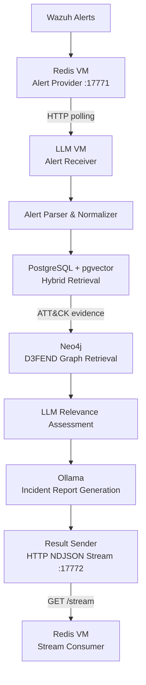
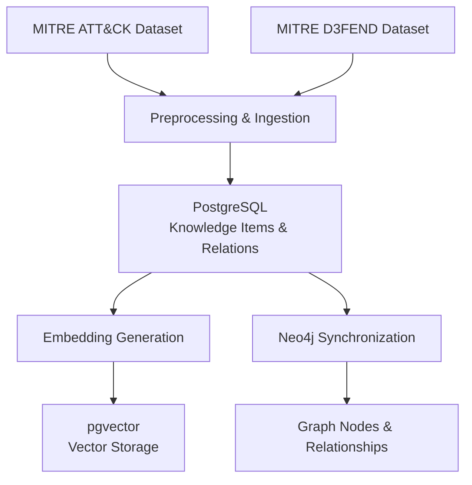

# RAG – System Architecture

## 1. Alert Processing Workflow

## 2. Knowledge Ingestion Workflow

## 3. Main Components

| Component | Responsibility |
|---|---|
| Alert Receiver | Retrieves enriched alerts from the Redis VM |
| Alert Parser | Normalizes alert data into compact retrieval context |
| PostgreSQL + pgvector | Stores knowledge and performs hybrid retrieval |
| Neo4j | Retrieves framework relationships and graph evidence |
| Relevance Assessment | Evaluates retrieved evidence against the alert |
| Ollama | Generates the incident analysis report |
| Result Sender | Streams generated reports to the Redis VM |

## 4. Communication

- Alert input: HTTP polling from the Redis VM on port `17771`.
- Report output: HTTP streaming through `GET /stream` on port `17772`.
- Database connections: PostgreSQL and Neo4j.
- LLM inference: Local Ollama service.

**Note:** The current alert processing workflow is sequential. The HTTP result stream uses NDJSON and is not Redis Pub/Sub or Redis Streams.
